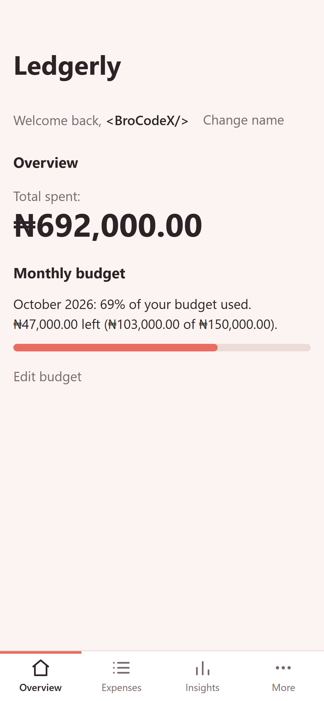
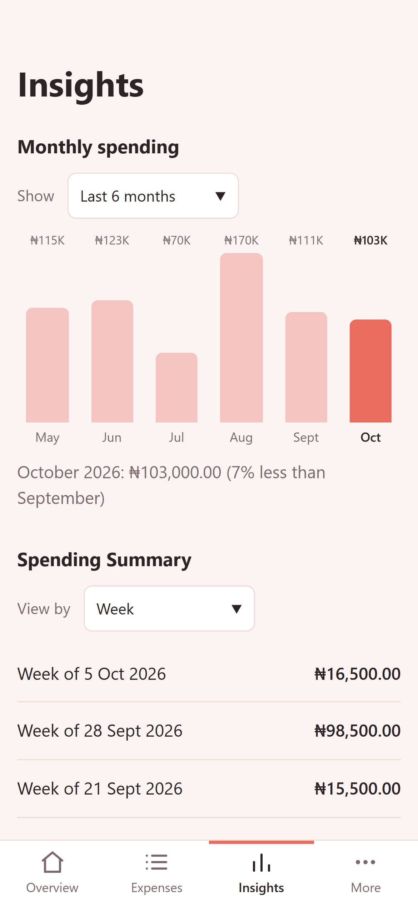
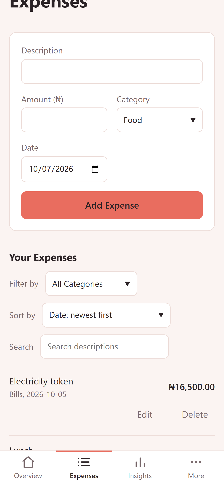
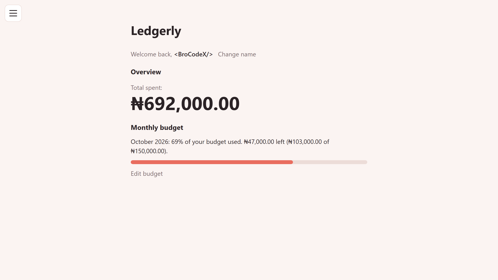
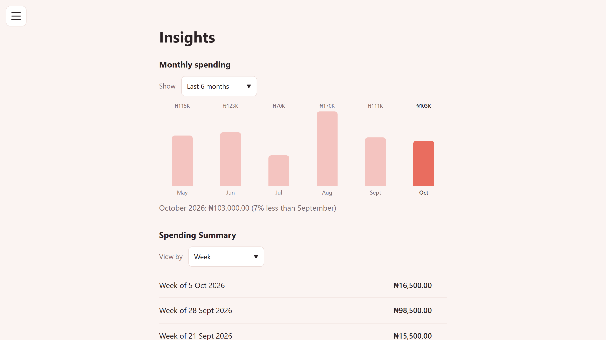

  

<h1 align="center">Ledgerly</h1>

  An offline-ready expense tracker in Naira, built as an installable web app.

  <a href="https://ledgerly-ng.vercel.app/"><strong>Open the live app</strong></a>

  
  
  

## What it does

- Add expenses in naira with a category and date, edit them later, and delete with a one-tap undo
- Set a monthly budget and watch a progress bar that warns you as you near the limit
- See spending per month in a bar chart, with a comparison to the previous month
- Break spending down by week, by month, and by category
- Search, filter, and sort your expenses
- Export to CSV, or back up and restore everything with a backup file
- Light and dark themes that follow your device, or switch by hand
- Install it on a phone or computer and use it fully offline
- Get a prompt when a new version is ready
- Works with a keyboard and with screen readers

## On a computer

  

  

## Install it

- **Android (Chrome):** open the app, go to **More**, and tap **Install Ledgerly**.
- **iPhone (Safari):** tap **Share**, then **Add to Home Screen**.
- **Computer (Chrome or Edge):** use the install icon in the address bar, or **More**, then **Install Ledgerly**.

## Built with

Plain HTML, CSS, and JavaScript. No frameworks or libraries.

- A service worker for offline use and fast loading
- A web app manifest so it can be installed
- Browser storage for your data
- Hosted on Vercel

Lighthouse scores (mobile): Performance 91, Accessibility 100, Best Practices 100, SEO 100.

## Privacy

Your data stays on your device. There are no accounts and no tracking, and nothing is sent to a server.

## What's next

- Sign-in and syncing across devices
- Support for other currencies

## About

Designed and built by **&lt;BroCodeX/&gt;**.

The source code is in a private repository. If you'd like to review it, get in touch through my GitHub profile.
